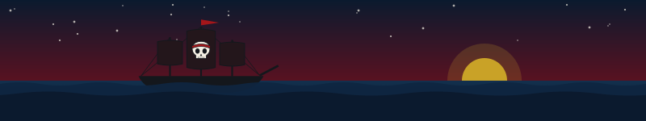
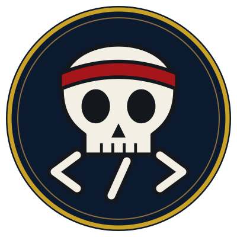
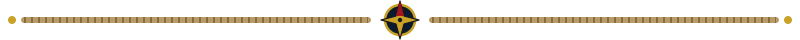
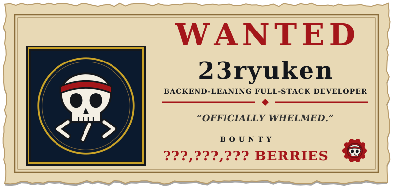
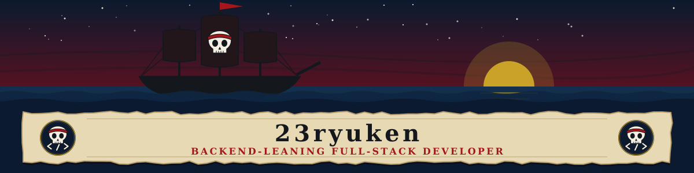

  

  

Nairobi, Kenya &nbsp;·&nbsp; Freelance

  

<!-- ============================ WHO AM I ============================ -->

  

<table align="center">
  <tr>
    <td width="30%" align="center" valign="middle">
      
    </td>
    <td width="70%" valign="middle">
      I'm a backend-leaning full-stack developer based in Nairobi, working as a freelancer. I trained at Moringa School and build with <b>Node.js</b>, <b>Express</b>, <b>MongoDB</b> and <b>PostgreSQL</b>, with <b>React</b> on the front end and <b>Python</b> when the project calls for it.
        
      Right now I'm building <b>TraceMind</b>, a tool that helps developers investigate errors, and <b>Manifest-Prime</b>, a way for freelancers to deliver finished work through a link they can track.
    </td>
  </tr>
</table>

<!-- ============================ PIRATE CREW ============================ -->

  

  
  
  
  
  <!--  -->
  

  

<!-- ============================ PIRATE'S LOG ============================ -->

  

<!-- STAGE 6: contribution snake, top languages card and stats card go here. -->

  

<!-- ============================ DEVIL FRUIT COLLECTION ============================ -->

  

<table align="center" width="80%">
  <tr>
    <td width="22%" valign="middle"><b>Languages</b></td>
    <td>
       
      
    </td>
  </tr>
  <tr>
    <td valign="middle"><b>Frontend</b></td>
    <td>
       
      
    </td>
  </tr>
  <tr>
    <td valign="middle"><b>Backend</b></td>
    <td>
       
      
    </td>
  </tr>
  <tr>
    <td valign="middle"><b>Databases</b></td>
    <td>
       
      
    </td>
  </tr>
  <tr>
    <td valign="middle"><b>Tools</b></td>
    <td>
       
      
    </td>
  </tr>
</table>

<!-- Add cloud/deployment or other rows here once confirmed, copying one <tr> block above. -->

  

<!-- ============================ PIRATE ADVENTURES ============================ -->

  

<table align="center" width="100%">
  <tr>
    <td width="50%" valign="top">
      
       
      <b><a href="https://github.com/23ryuken/TraceMind">TraceMind</a></b>
        
      A debugging investigation tool that captures errors together with the evidence available, then uses AI to investigate why an error may have happened.
        
      <b>Language:</b> Python &nbsp;·&nbsp; <a href="https://github.com/23ryuken/TraceMind">Repository</a>
      <!-- Live demo: add <a href="YOUR_DEMO_URL">Live demo</a> to the line above when one exists. -->
    </td>
    <td width="50%" valign="top">
      
       
      <b><a href="https://github.com/23ryuken/Manifest-Prime">Manifest-Prime</a></b>
        
      Client delivery for freelancers and small studios: send finished work through a polished link, and know when it was opened and downloaded.
        
      <b>Language:</b> JavaScript &nbsp;·&nbsp; <a href="https://github.com/23ryuken/Manifest-Prime">Repository</a>
    </td>
  </tr>
</table>

  

<!-- ============================ BOUNTY BOARD ============================ -->

  

<table align="center">
  <tr>
    <td align="center" valign="middle" width="90">
      
    </td>
    <td valign="middle">
      <b>Moringa School</b> 
      Completed the software development training program.
    </td>
  </tr>
  <!-- Add more milestones by copying the <tr> block above. -->
</table>

<!-- ============================ PIRATE'S CODE ============================ -->

  

  <i>Maps are drawn by the people who sail them. 
  I ship early, read every error as a chart of the waters ahead, 
  and value the crew I build with as much as the code I write. 
  The horizon moves. So do I.</i>

  

