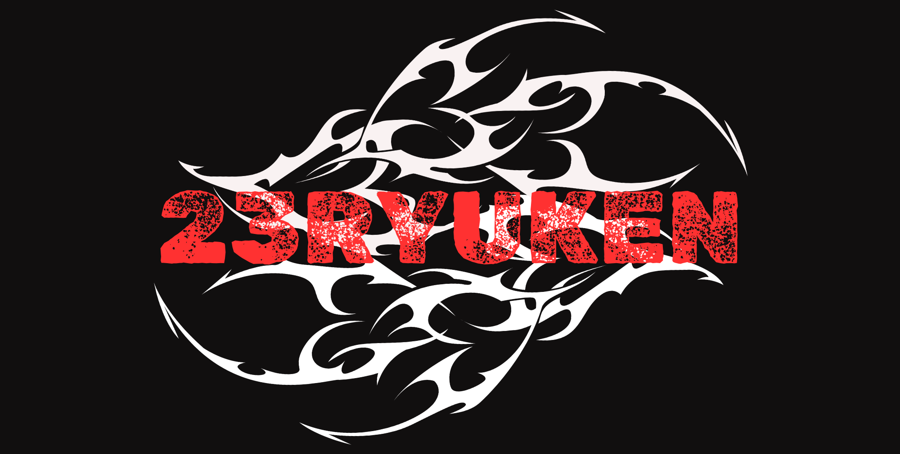

  

<h2 align="center">Tech Stack</h2>

<table align="center" width="72%">
  <tr>
    <td width="22%" valign="middle"><b>Languages</b></td>
    <td align="left" valign="middle">
      
    </td>
  </tr>
  <tr>
    <td valign="middle"><b>Frontend</b></td>
    <td align="left" valign="middle">
      
    </td>
  </tr>
  <tr>
    <td valign="middle"><b>Backend</b></td>
    <td align="left" valign="middle">
      
    </td>
  </tr>
  <tr>
    <td valign="middle"><b>Databases</b></td>
    <td align="left" valign="middle">
      
    </td>
  </tr>
  <tr>
    <td valign="middle"><b>Tools</b></td>
    <td align="left" valign="middle">
      
    </td>
  </tr>
</table>

-----------

  

